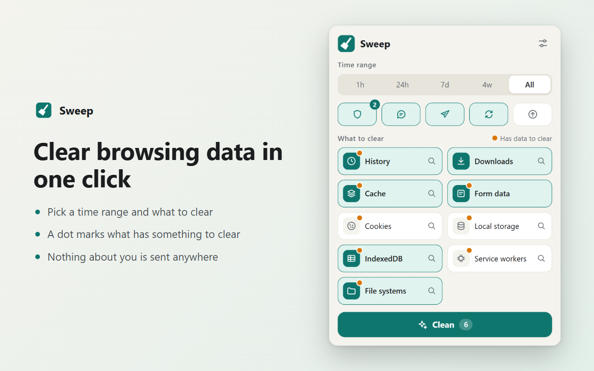
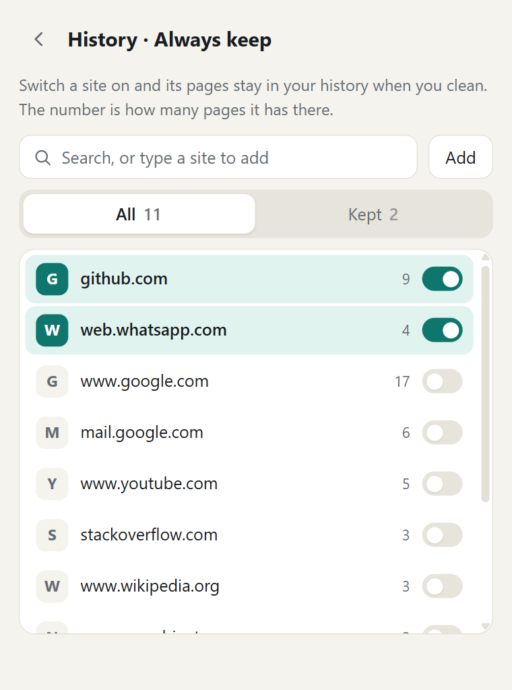

# Sweep

Clear your browsing data in one click, and keep the sites that matter.

Sweep is a browser extension for Chrome, Brave and Firefox. Pick a time range, pick what to clear, press Clean. It has no account, no analytics and no ads.

It is tested in Chrome, Brave and Firefox. It should also run in Edge and other Chromium browsers, but has not been tested there, and the update check does not cover them.

## What it does

- **Clears what you choose**: history, downloads, cache, form data, cookies, local storage, IndexedDB, service workers, and file systems (Chromium) or saved passwords (Firefox).
- **Shows what there is to clear**: a dot marks each kind of data that has something in it.
- **Keeps the sites you pick**: every kind of data has its own keep list. Open the magnifier on an item and switch a site on; it is left alone when you clean.
- **Cookie whitelist**: sites whose cookies are never cleared. It can be switched off and on without losing the list.
- **Stays signed in to WhatsApp Web and Telegram Web** (Chromium only).
- **Cleans automatically** when the browser closes. A browser exits before an extension can finish, so the work is completed the next time the browser starts.
- **Checks for a newer browser version**, if you switch that on. It is off by default and is the only feature that uses the network.
- English and Traditional Chinese, light and dark.

## Install

### Chrome, Brave and other Chromium browsers

A Chrome Web Store listing is being prepared. Until it is live, load it from source:

1. Run `.\build.ps1`.
2. Open `chrome://extensions` and turn on **Developer mode**.
3. Click **Load unpacked** and choose `dist\chromium`.

### Firefox

Release Firefox only installs add-ons signed by Mozilla.

- To try it for one session: open `about:debugging#/runtime/this-firefox`, click **Load Temporary Add-on**, and choose `dist\firefox\manifest.json`. Automatic cleaning does not work in a temporary install.
- To install it for good: run `.\sign-firefox.ps1` with your own Mozilla API credentials, then drag the `.xpi` from `signed\` into Firefox. You will need to change the add-on ID in `manifest.firefox.json` to one of your own first, because an ID can only be signed by the account that owns it.

## What differs between browsers

Browsers do not give extensions the same abilities, so a few things differ.

| | Chrome, Brave | Firefox |
|---|---|---|
| File systems | Yes | Not available |
| Saved passwords | Ignored by the browser, so not offered | Yes |
| Keep lists | Everything except form data | History, downloads and cookies |
| Time range for local storage, IndexedDB and service workers | Any | "All" only |
| Stay signed in to WhatsApp Web and Telegram Web | Yes | Not available |
| Update check | Chrome: any newer version. Brave: major versions only | Any newer version |

Form data can only be cleared all at once in every browser, so it has no keep list.

## Permissions and privacy

| Permission | What it is used for |
|---|---|
| `browsingData` | Removing the data you selected. |
| `storage` | Saving your settings on your device. |
| `history` | Showing whether there is history to clear, listing sites in a keep list, and removing history entries while leaving kept sites. |
| `downloads` | The same three things for download records. Sweep never touches the downloaded files. |
| `cookies` and access to all sites (Firefox, optional) | Requested only when you keep cookies for some sites, to find which sites have cookies. Cookie values are not read. |

Nothing about you is collected or sent anywhere. The one network request Sweep can make is the optional update check, which reads a public list of browser releases. The full policy is in [store/privacy-policy.md](store/privacy-policy.md).

## Build and test

The scripts are PowerShell and were written on Windows. The tests need Node 22 or newer and no packages.

| Command | What it does |
|---|---|
| `.\build.ps1` | Builds `dist\chromium` and `dist\firefox` from `src\`. |
| `.\test.ps1` | Builds, runs the unit tests, then the end-to-end tests in every installed browser. |
| `.\test.ps1 chrome` | The same for one browser: `brave`, `chrome`, `edge` or `firefox`. |
| `.\package-chromium.ps1` | Packs the Chrome Web Store upload into `store\`. |
| `.\sign-firefox.ps1` | Gets the Firefox build signed by Mozilla as an unlisted add-on. |

The end-to-end tests drive real browsers with throwaway profiles in the system temp folder, so your own browsing data is never touched. The test sites are answered locally and nothing goes to the network, apart from one check that reads the public release list for the update feature.

Browsers only tell an extension that they have started when it is properly installed, which an automated test cannot do. `tests\e2e\installed.js` covers that case with a dedicated test profile; the comment at the top of the file explains how to set it up.

## Layout

| Path | Contents |
|---|---|
| `src\` | The extension, shared by both builds. `clean.js` holds the cleaning logic, `update.js` the update check. |
| `manifest.chromium.json`, `manifest.firefox.json` | One manifest per build. |
| `tests\unit\`, `tests\e2e\` | Unit tests and end-to-end tests. |
| `store\` | Chrome Web Store listing text, images and the privacy policy. |
| `tools\` | The script that draws the icons. |

## Licence

[MIT](LICENSE)
